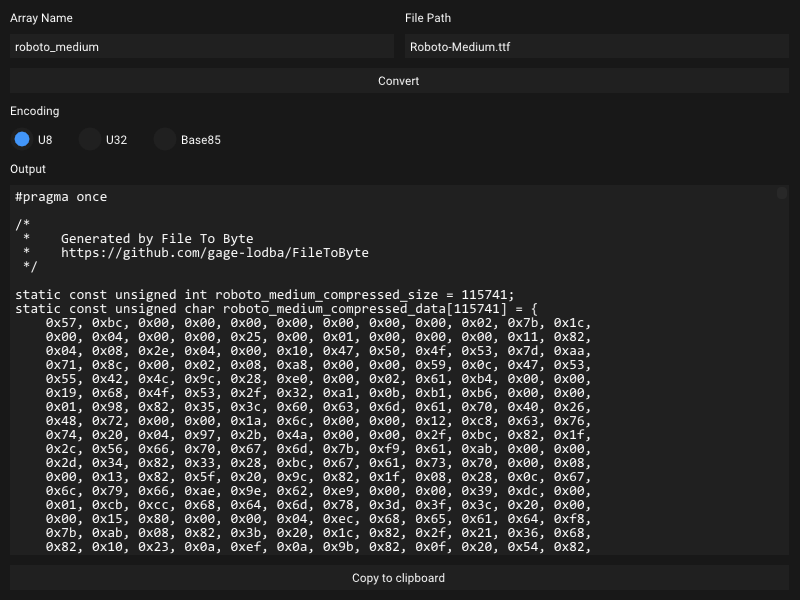

<div align="center">

  <h1>FileToByte</h1>

  <a href="https://github.com/gage-lodba/FileToByte/actions/workflows/BuildAndRelease.yml">
    
  </a>

</div>

FileToByte is a utility that transforms any file into a compressed C-style
array, ready to drop straight into C++ source for easy in-memory handling —
handy for embedding fonts, icons, shaders, or any asset directly into a binary.

You can download the latest binaries from [Releases](https://github.com/gage-lodba/FileToByte/releases/latest).

<div align="center">
  
</div>

## Usage

1. Enter an **Array Name** (the C symbol prefix, e.g. `myfont`) and the
   **File Path** to convert. Paths are treated as UTF-8, so non-ASCII names work.
2. Pick the output **Encoding**.
3. Click **Convert**.
4. Click **Copy to clipboard**, or enter an **Output Path** and click
   **Save to file** to write the generated header directly.

The result box is read-only; conversion errors and save confirmations appear in
a status line above it.

Notes and limits:

- The input file is compressed with `stb_compress` and then encoded, so the
  output stays compact. Inputs are limited to **16 MiB**; larger files are
  rejected with an explanatory message instead of exhausting memory.
- The Array Name must be a valid C identifier (`[A-Za-z][A-Za-z0-9_]*`).
- Changing the encoding after a successful conversion re-runs it, so the output
  always matches the selected encoding.
- The generated arrays match Dear ImGui's
  `AddFontFromMemoryCompressed*TTF` loaders.

| Encoding | Output symbol | Notes |
| --- | --- | --- |
| **U8** (default) | `unsigned char <name>_compressed_data[]` | Hex bytes (`0x..`); endianness-independent |
| **U32** | `unsigned int <name>_compressed_data[]` | `0x........` words; endianness-dependent |
| **Base85** | `const char <name>_compressed_data_base85[]` | Smallest source; load via the Base85 loader |

## Building from source

FileToByte pulls in the [VulkanWindow](https://github.com/gage-lodba/VulkanWindow)
scaffold as a git submodule (which itself vendors GLFW, Dear ImGui, and
VulkanMemoryAllocator), so clone recursively:

```bash
git clone --recursive https://github.com/gage-lodba/FileToByte.git
cd FileToByte
cmake -B build -DCMAKE_BUILD_TYPE=Release
cmake --build build --config Release
```

Already cloned without `--recursive`? Fetch the submodules first:

```bash
git submodule update --init --recursive
```

The binary is written to `build/FileToByte` (Linux) or
`build/Release/FileToByte.exe` (Windows, Visual Studio generator).

### Dependencies

- [CMake](https://cmake.org/) ≥ 3.20
- A C++23-capable compiler (GCC 13+, Clang 16+, or a recent MSVC / VS 2022);
  the vendored dependencies need C++20 at minimum
- The [Vulkan SDK](https://www.vulkan.org/) — or system Vulkan headers + loader

GLFW, Dear ImGui, and VulkanMemoryAllocator come in transitively through the
VulkanWindow submodule, so there's nothing else to install.

### Windows runtime requirements

The default Release binary links against the Vulkan loader and the Microsoft
C/C++ runtime:

- **Vulkan loader** (`vulkan-1.dll`) — installed with graphics drivers or the
  [Vulkan runtime](https://vulkan.lunarg.com/sdk/home#windows).
- **Microsoft Visual C++ runtime** (`MSVCP140.dll`, `VCRUNTIME140*.dll`) — from
  the [VC++ redistributable](https://learn.microsoft.com/cpp/windows/latest-supported-vc-redist).

Alternatively, build with `-DFILETOBYTE_STATIC_CRT=ON` to statically link the
MSVC runtime; the resulting executable then only needs the Vulkan loader:

```bash
cmake -B build -DFILETOBYTE_STATIC_CRT=ON
cmake --build build --config Release
```

### Build options

| Option | Default | Purpose |
| --- | --- | --- |
| `FILETOBYTE_STATIC_CRT` | `OFF` | Strips the MSVC runtime DLL dependency (MSVC only) |
| `BUILD_TESTING` | `ON` | Builds the converter test suite (`ctest`) |

## Tests

The converter has a self-contained test suite (`tests/`) covering round-trips
for all three encodings, error mapping, path handling, the input-size cap and
concurrent conversions:

```bash
# Single-config generators (Ninja, Makefiles)
ctest --test-dir build --output-on-failure

# Multi-config generators (Visual Studio)
ctest --test-dir build -C Release --output-on-failure
```

## Development tooling

- `.clang-format` — Google style with pointer alignment pinned so clang-format
  18, 20, 21 and 22 produce identical output. CI formats `source/` and `tests/`
  with clang-format 18.
- `.clang-tidy` — `clang-diagnostic-*`, `clang-analyzer-*`, `modernize-*` and
  `google-*` check families. The config requires **clang-tidy ≥ 19** (it uses
  `ExcludeHeaderFilterRegex`); CI installs a pinned 19.1.0 and asserts the
  version rather than silently falling back to default checks.
- `.clangd` — points at the `build/` compile database; use a single-config
  generator (e.g. `cmake -B build -G Ninja`) so `compile_commands.json` is
  generated.

## Third-party notices

FileToByte bundles third-party code and fonts (VulkanWindow, Dear ImGui,
VulkanMemoryAllocator, GLFW, stb, Roboto and JetBrains Mono). License texts and
attribution are in [THIRD-PARTY.md](THIRD-PARTY.md) and [`licenses/`](licenses/);
`THIRD-PARTY.md` and `licenses/` accompany the release binaries as well.

## License

FileToByte is released under the MIT License — see [LICENSE](LICENSE). Bundled
components are covered by their own licenses (see above).
